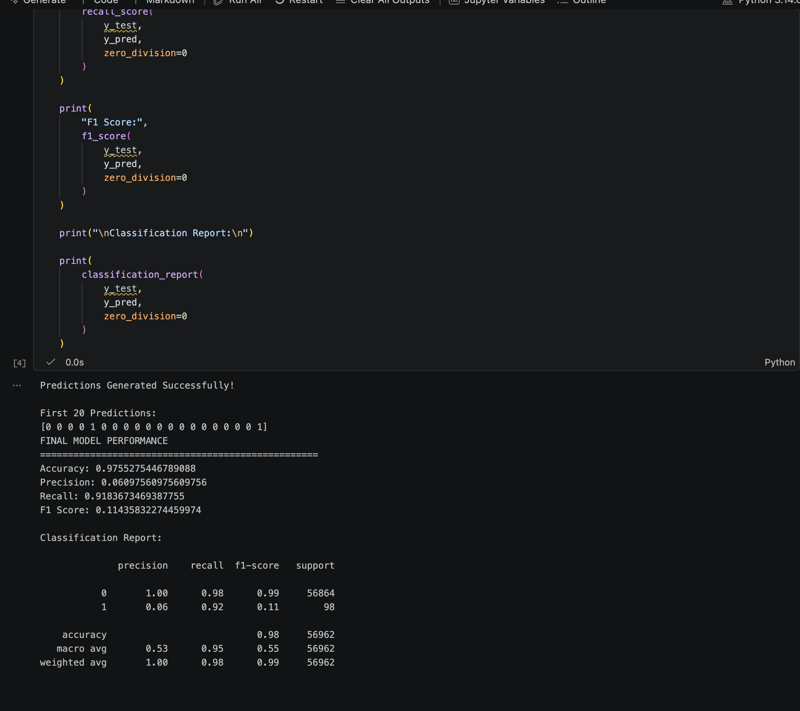
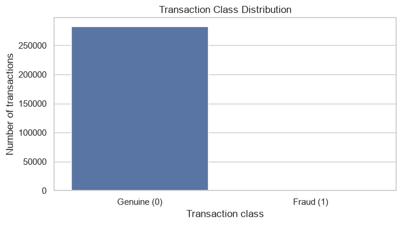
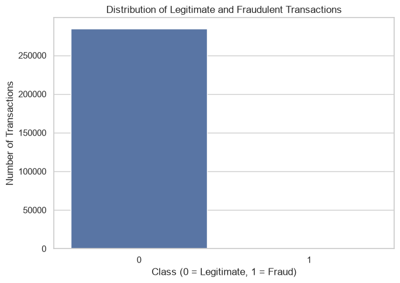
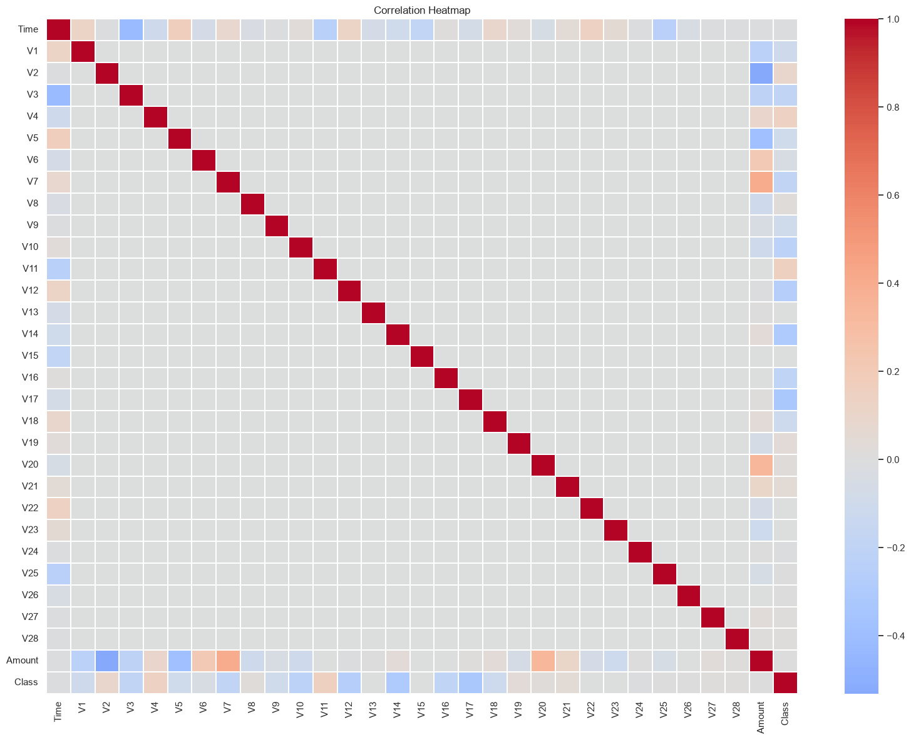
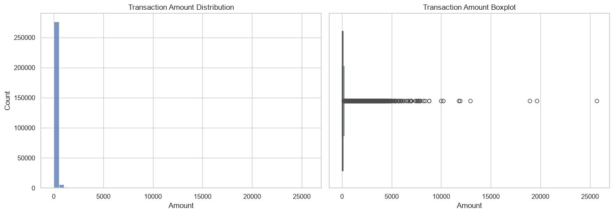
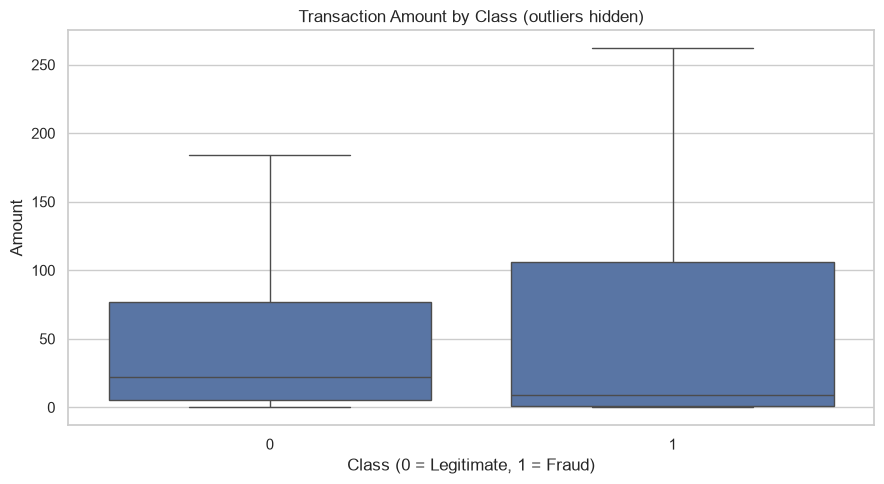
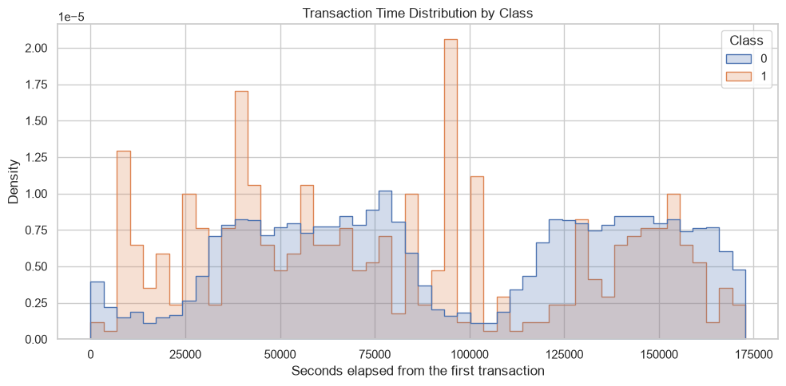
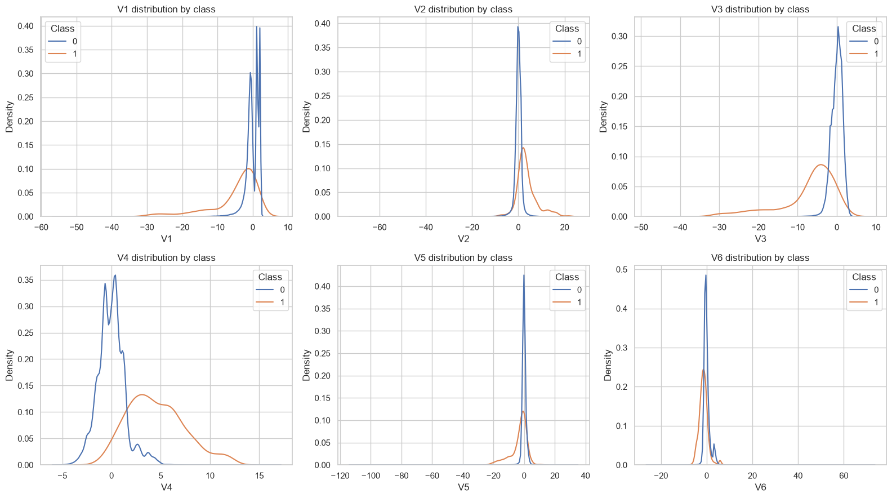

# Credit Card Fraud Detection Using Logistic Regression


Classifies credit card transactions as legitimate (`0`) or fraudulent (`1`) on an imbalanced dataset using Logistic Regression and Python (`pandas`, `scikit-learn`, `seaborn`, `imbalanced-learn`).

---

## Team & Roles

| Member Name | Entry No. | Role | GitHub Handle |
| :--- | :--- | :--- | :--- |
| **Ravicharan** | `2026ESB1479` | Documentation Lead | [@Ravicharan02](https://github.com/Ravicharan02) |
| **Krishna** | `2026EEB1368` | Execution Lead | [@Krxna04](https://github.com/Krxna04) |
| **Roshini** | `2026MCB1578` | PPT Lead | [@rose-2030](https://github.com/rose-2030) |
| **Sidhart** | `2026AIB1093` | Video Lead | [@ravansidharth-cpu](https://github.com/ravansidharth-cpu) |

---

## 1. Project Description

Credit Card Fraud Detection is a machine learning project that aims to identify fraudulent credit card transactions using **Logistic Regression**.

The project uses transaction data to classify each transaction into one of two categories:
* **0** – Legitimate Transaction
* **1** – Fraudulent Transaction

The main objective is to build a machine learning model that can detect fraudulent transactions accurately while minimizing incorrect predictions.

---

## 2. Problem Statement

Credit card fraud is a major concern in digital financial transactions. Detecting fraudulent transactions is challenging because fraudulent transactions represent only a very small portion of all transactions (~0.17%).

This project uses machine learning techniques to analyze transaction patterns and identify potentially fraudulent activities.

---

## 3. Objectives

* To analyze and understand the credit card transaction dataset.
* To perform Exploratory Data Analysis (EDA).
* To preprocess and prepare the data for machine learning.
* To handle the class imbalance present in the dataset.
* To train a Logistic Regression classification model.
* To evaluate the model using appropriate performance metrics.
* To identify fraudulent transactions effectively.

---

## 4. Dataset

* **Dataset Name:** Credit Card Fraud Detection Dataset
* **Source:** [Kaggle - Credit Fraud: Dealing with Imbalanced Datasets](https://www.kaggle.com/code/janiobachmann/credit-fraud-dealing-with-imbalanced-datasets/notebook)
* **File Name:** `creditcard.csv`
* **Target Column:** `Class` (`0` = Normal transaction, `1` = Fraudulent transaction)
* **Features:** Contains `Time`, `Amount`, and anonymized numerical features (`V1`–`V28`).

> **Note:** The dataset is not included in this repository because of its large file size. Download `creditcard.csv` from Kaggle and place it inside the `data/` directory before running the scripts.

---

## 5. Technologies Used

* Python 3.14
* Jupyter Notebook
* Pandas & NumPy
* Scikit-learn
* Matplotlib & Seaborn
* Git and GitHub
* nbformat
* os library
---

## 6. Machine Learning Algorithm

**Logistic Regression**

Logistic Regression is a supervised machine learning algorithm used for binary classification. In this project, it is used to classify credit card transactions as legitimate or fraudulent. Class balancing techniques (e.g., undersampling / SMOTE) are applied to address the severe imbalance between classes.

---

## 7. Project Workflow

1. Dataset collection and loading.
2. Data exploration and statistical analysis.
3. Exploratory Data Analysis (EDA).
4. Data preprocessing and feature scaling (`Time` and `Amount`).
5. Splitting the dataset into training and testing sets.
6. Training the Logistic Regression model.
7. Predicting transaction classes.
8. Evaluating model performance.
9. Visualizing and exporting evaluation results into `outputs/` or `results/plots/`.

---
## 8. How to Run the Project

Using Jupyter Notebook
1. Open the project directory in VS Code or Jupyter Notebook.
2. Download the dataset from the given drive link in the data folder and save it in the same folder of the cloned repository.
3. Open the src folder
4. Open fraud_detection.ipynb.
5. Make sure the dataset path is correct.
6. Select the Python kernel.
7. Run all cells sequentially.
8. Observe the model training, predictions, and evaluation results.
--- 

## 9. Model Evaluation

The model is evaluated using the following performance metrics:
* Accuracy
* Precision
* Recall
* F1-Score
* Confusion Matrix
* ROC-AUC Score

---

## 10. Project Structure

```text
AI101/
├── data/                                    # Dataset folder
│   └── README.txt                           # Instructions to download creditcard.csv
├── outputs/                                 # Output directory
│   └── graphs/                              # Visualizations and exported figures
│       ├── amount_by_class.png
│       ├── class_distribution.png
│       ├── correlation_heatmap.png
│       ├── legitimate_vs_fraud_distribution.png
│       ├── log_amount distribution.png
│       ├── terminal_evaluaton.png
│       ├── time_distribution.png
│       ├── transaction_plot.png
│       └── v1_v6_class_distribution.png
├── src/                                     # Source Jupyter Notebooks
│   ├── data_exploration.ipynb               # Exploratory Data Analysis (EDA)
│   ├── evaluation.ipynb                     # Model evaluation and metrics
│   ├── fraud_detection.ipynb                # End-to-end fraud detection pipeline
│   ├── model_training.ipynb                 # Logistic Regression model training
│   └── preprocessing.ipynb                  # Data cleaning and feature scaling
├── .gitignore                               # Files/folders ignored by Git
├── README.md                                # Main project documentation
└── requirements.txt                         # Pinned dependencies
```
## 📂 Folder Descriptions

| Folder / File | Description |
| :--- | :--- |
| **`data/`** | Contains dataset location setup and `README.txt` instructions to download `creditcard.csv`. |
| **`outputs/graphs/`** | Stores generated plots, distribution charts, and model evaluation screenshots. |
| **`src/`** | Contains modular Jupyter Notebooks for EDA, preprocessing, training, evaluation, and the complete end-to-end pipeline (`fraud_detection.ipynb`). |
| **`requirements.txt`** | Lists all required Python dependencies and package versions. |
| **`README.md`** | Main repository documentation containing project details, setup, and team roles. |
| **`.gitignore`** | Specifies untracked files (e.g., dataset files, virtual environments) to ignore in Git. |
---

## 11. Installation and Setup

### Step 1: Clone the repository
```bash
git clone [https://github.com/Krxna04/AI101.git](https://github.com/Krxna04/AI101.git)
```

### Step 2: Navigate to the project directory
```bash
cd AI101
```

### Step 3: Create and activate a virtual environment
```bash
python -m venv venv

# On Windows:
venv\Scripts\activate

# On macOS/Linux:
source venv/bin/activate
```

### Step 4: Install the required libraries
```bash
pip install -r requirements.txt
```

### Step 5: Download the dataset
Download `creditcard.csv` from Kaggle and place it inside the `data/` directory:
```text
AI101/data/creditcard.csv
```

---

## 12. How to Run the Project

### Option 1: Running the Complete Pipeline Notebook
1. Open the repository in VS Code or launch Jupyter Notebook (`jupyter notebook`).
2. Open **`src/fraud_detection.ipynb`**.
3. Select the active Python virtual environment kernel.
4. Click **Run All** to execute the full pipeline end-to-end.
* **Expected Runtime:** `< 45 seconds`.

### Option 2: Running Modular Notebooks Step-by-Step
Run the individual notebooks inside `src/` in sequential order:
1. `src/data_exploration.ipynb` – Inspects dataset summary, class balance, and feature distributions.
2. `src/preprocessing.ipynb` – Cleans data and applies scaling to `Time` and `Amount`.
3. `src/model_training.ipynb` – Trains the Logistic Regression classifier.
4. `src/evaluation.ipynb` – Generates evaluation metrics, confusion matrix, and classification reports.

---

## 13. Expected Output & Results

Running the notebooks executes data preprocessing, trains the Logistic Regression classifier, prints evaluation metrics in the output console, and exports exploratory and evaluation charts into `outputs/graphs/`.

### A. Console Output & Evaluation Metrics

| Metric | Score |
| :--- | :--- |
| **Accuracy** | `0.9755` (97.55%)[cite: 4, 11] |
| **Precision** | `0.0610` (6.10%)[cite: 4, 11] |
| **Recall** | `0.9184` (91.84%)[cite: 4, 11] |
| **F1 Score** | `0.1144` (11.44%)[cite: 4, 11] |

#### Execution Console Screenshot:
.

#### Detailed Classification Report:
```text
              precision    recall  f1-score   support

           0       1.00      0.98      0.99     56864
           1       0.06      0.92      0.11        98

    accuracy                           0.98     56962
   macro avg       0.53      0.95      0.55     56962
weighted avg       1.00      0.98      0.99     56962
```

---

### B. Generated Visual Plots (`outputs/graphs/`)

#### 1. Transaction Class Distribution
Visualizing the extreme class imbalance (`284,315` legitimate vs `492` fraudulent transactions):

| Genuine vs Fraud Distribution | Legitimate vs Fraudulent Transactions |
| :---: | :---: |
| [cite: 16, 17] | |

#### 2. Feature Correlation Heatmap
Correlation matrix across `Time`, `Amount`, PCA components (`V1`–`V28`), and target `Class`:



#### 3. Amount & Feature Distributions

| Transaction Amount Overview | Transaction Amount by Class |
| :---: | :---: |
|  | |

| Log-Transformed Amount Distribution | Transaction Time Distribution by Class |
| :---: | :---: |
|  |  |

#### 4. PCA Feature Density Distributions (V1–V6)


---

## 14. Deliverables & Links

* **Presentation Slides:** [View Presentation PDF](docs/Credit%20Card%20Fraud%20Detection_Team%2043.pdf)
* **Presentation Slides Google drive (Incase the file does not render on Github):** [View presentation PDF](https://drive.google.com/file/d/13ypC36GMR2nqNeZ4ezZNyWUnopXg8U2v/view?usp=sharing)
* **Video Demonstration:** [Click here to watch Demo Video](https://drive.google.com/file/d/1Vrd3OgIZHvUhb0mu-1l7AH41KlRc0fgp/view?usp=sharing)

---

## 15. AI-Use Disclosure

* **Generative AI Tools Used:** ChatGPT & Gemini
* **Scope of Usage:** Assisted in conceptual clarification, debugging Python import statements, and structuring documentation.
* **Verification Statement:** All code implementation, analysis logic, and documentation were reviewed, tested, and verified independently by the team members
---
